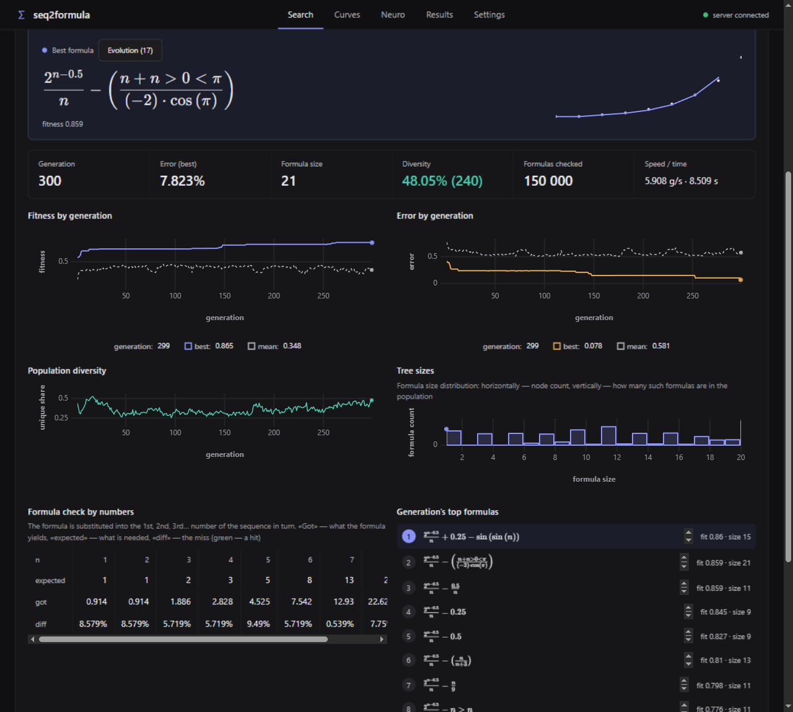

# seq2formula

**English** · [Русский](README.ru.md)


**Watch evolution discover the mathematical formulas behind number sequences.**

Have you ever looked at a sequence like `1 2 4 8 16` and wondered, *"What is the formula behind these numbers?"* 

seq2formula answers this by running a genetic algorithm in your browser. It breeds, mutates, and crosses mathematical expressions, showing you the live search process. It feels less like a black-box calculator and more like watching a digital gardener grow an answer.



Everything runs locally on your machine. No internet access, no telemetry, and no external APIs. Just a Python engine doing the math and a sleek dashboard showing the show.

## Features

- **Live Search Dashboard**: Watch formulas evolve in real-time with detailed charts for fitness, error, and population diversity.
- **Curve Mode**: The same engine fits parametric formulas to 2D point sets — draw a circle, a spiral, a wave or even a multi-stroke smiley, and watch the search match your shape on a canvas.
- **Neuro Engine (Stage 2)**: A reinforcement-learning alternative to the genetic search — a small neural policy (numpy only) assembles formulas token by token and trains live, with its own `/neuro` page full of learning curves, policy entropy and "what the network is thinking" token bars. A memetic refinement pass (local algebraic tweaks of the top formulas) lifted the hard tier to 11/13 puzzles.
- **Autopilot (Batch Mode)**: Queue up the entire library and let the engine solve puzzles one by one in the background.
- **Advanced Math**: The engine supports basic arithmetic, roots, factorials, floor, trigonometry (`sin`, `cos`), logarithms, and constants like π and e.
- **65 Built-in Sequences**: A curated library of puzzles ranging from simple linear progressions to famous sequences like Fibonacci and Catalan numbers.
- **Custom Sequences**: Input your own numbers, specify a reference formula, and watch the engine find it.
- **Reproducibility**: Enter a "seed" number to replay the exact same evolutionary search, or leave it blank for a fresh random run.

## How it works

- **Values over Text**: The engine doesn't care if it finds `2*n` or `n+n`. If the numbers match, the formula is correct.
- **Parsimony Penalty**: Evolution naturally prefers shorter, more elegant formulas. Without this, it would just breed giant, unreadable monsters that happen to fit the numbers.
- **Accuracy**: A formula is scored by testing it against your sequence (e.g., for `n = 1, 2, 3...`). The closer the output values are to your target, the higher the score.

## Dashboard

The dashboard is built to be watched. The live view shows the best current formula rendered in beautiful typography, a top-5 leaderboard, and a live event feed. A mini-chart plots the found formula directly against your target sequence. 
The Results tab tracks your history, maintains a "Hall of Fame" of the shortest formulas ever found, and collects "Curiosities" (absurd, near-miss formulas). You can pause, step through generation-by-generation, or accelerate the search at any time.

The «Кривые» tab (curve mode) streams the same kind of statistics while the engine fits a formula curve to a target shape drawn on canvas — with a snap grid, eraser, stroke smoothing, server-side saved drawings (they survive any browser) and a gallery of near-miss "curve curiosities". Both modes can replay the search: the sequence hero steps through every champion formula the run produced, and the curve tab animates the found formula as if a pen were drawing it. The «Нейро» tab opens the standalone neuro training page: reward and error curves, policy entropy, token probability bars and the best formula found so far, rendered with KaTeX.

## Getting started

Requires Python 3.10+.

On Windows:
```bat
git clone https://github.com/OlyoshaOlyosha/seq2formula.git
cd seq2formula
python -m venv .venv
.venv\Scripts\pip install -r requirements.txt
run.bat
```

On Mac / Linux:
```bash
git clone https://github.com/OlyoshaOlyosha/seq2formula.git
cd seq2formula
python3 -m venv .venv
source .venv/bin/activate
pip install -r requirements.txt
chmod +x run.sh
./run.sh
```

The server will automatically find a free port (usually `http://127.0.0.1:8002`) and open your browser.

## Status and directions

Experimental, in continuous development.

- Stage 1 (done) — genetic programming engine with a post-solution
  "shrink" phase, live dashboard, operator picker, built-in puzzle
  library of graded difficulty.
- Grammar v2 (done) — unary functions (roots, factorial, trigonometry,
  logarithm), the remainder operator, and the π / e constants, with the
  picker regrouped into basic and advanced sets; puzzle tiers T4/T5
  showcase the new operations (65 puzzles in total).
- Performance and search quality (done) — compiled-formula evaluation
  (~3× faster generations), diversity mechanics (fitness sharing,
  adaptive anti-stagnation shocks, weighted parsimony), and a settings
  sweep over the whole library; the live feed renders formulas with math
  typography, and any formula can be plotted next to its sequence.
- Curve mode (done) — a second engine that fits parametric formulas to
  2D shapes on a canvas: shape presets, multi-stroke drawings, numpy
  batch fitness and generic search tuning (trig seeds, coherent blocks,
  memetic refinement).
- Stage 2 — neuro engine (done) — a reinforcement-learning policy on
  numpy that assembles formulas token by token and trains live per
  puzzle, with a dedicated training-visualizer page.
- Later — recurrences, neuro on higher-difficulty tiers, more statistics,
  more tuning experiments.

## Notes

- The dashboard UI is Russian — the project is developed for personal use
  first.
- No license yet; the decision is deliberately deferred.
