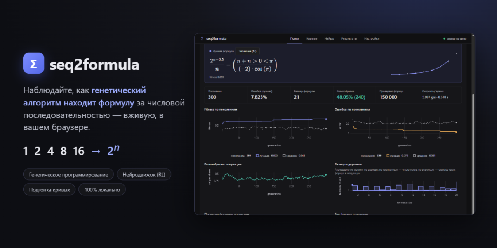
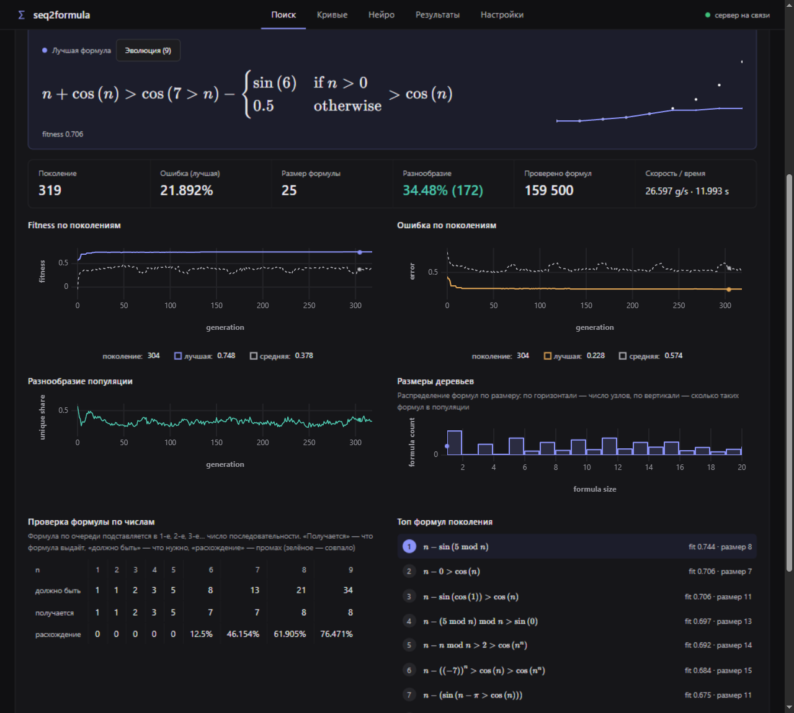

# seq2formula

[English](README.md) · **Русский**

[](https://github.com/OlyoshaOlyosha/seq2formula/releases)




**Наблюдайте за эволюцией, которая ищет математические формулы для числовых последовательностей.**

Задумывались ли вы, какая формула скрывается за числами `1 2 4 8 16`? 

seq2formula отвечает на этот вопрос, запуская генетический алгоритм прямо в вашем браузере. Программа скрещивает и мутирует математические выражения, в реальном времени показывая весь процесс поиска. Это не просто чёрный ящик с ответом — это увлекательное зрелище эволюции формул.

Всё работает локально на вашем компьютере. Никаких подключений к интернету, телеметрии или внешних API. Только Python-движок, который ищет формулы, и удобный дашборд, который показывает результат.

## Возможности

- **Живой дашборд:** Наблюдайте за эволюцией формул в реальном времени с подробными графиками приспособленности, ошибок и разнообразия популяции.
- **Режим «Кривые»:** Тот же движок подбирает параметрические формулы для 2D-точек — нарисуйте окружность, спираль, волну или даже многоштриховой смайлик и смотрите, как поиск подгоняет кривую под форму на холсте.
- **Нейродвижок (стадия 2):** Обучение с подкреплением как альтернатива генетическому поиску — небольшая нейросеть на numpy собирает формулы токен за токеном и обучается вживую; у неё отдельная страница `/neuro` с кривыми обучения, энтропией политики и «мыслями сети» в виде полосок вероятностей токенов. Степенные токены с выражениями в основании и голый `n^n`, а также меметическая доводка (локальные алгебраические улучшения лучших формул) подняли сложный тир до 13/13.
- **Режим Автопилота:** Поставьте в очередь всю библиотеку и позвольте движку решать задачи одну за другой в фоновом режиме.
- **Продвинутая математика:** Поддержка базовой арифметики, корней, факториалов, округления вниз (floor), тригонометрии (`sin`, `cos`), логарифмов, констант (π, e), возведения в степень с защитным правилом (степени строятся только из константного основания, константного показателя или `n` — никаких убегающих `2^99999`) и опциональной развилки `if` (сравнения как значения 0/1, красивый рендер «если… иначе»).
- **Двуязычный интерфейс:** Английский по умолчанию (определяется автоматически по браузеру), русский в комплекте; язык переключается в настройках.
- **66 встроенных последовательностей:** Библиотека от простых линейных прогрессий до известных последовательностей вроде чисел Фибоначчи и Каталана.
- **Свои последовательности:** Введите свои числа, задайте эталонную формулу и наблюдайте за её поиском.
- **Воспроизводимость:** Введите «сид» (seed), чтобы повторить тот же самый процесс поиска, или оставьте поле пустым для случайного прогона.

## Как это работает

- **Правильность по значениям:** Движку неважно, найдёт он `2*n` или `n+n`. Если числа совпадают — формула верна.
- **Штраф за сложность:** Эволюция естественным образом отдаёт предпочтение коротким и красивым формулам. Без этого она порождала бы гигантских нечитаемых монстров, которые случайно совпадают с числами.
- **Точность:** Формула оценивается путём подстановки в неё ваших чисел (например, `n = 1, 2, 3...`). Чем ближе результат к вашей последовательности, тем выше оценка.

## Дашборд



Дашборд создан для наблюдения. На главном экране отображается лучшая текущая формула в красивой математической вёрстке, топ-5 лидеров и живая лента событий. Мини-график визуально сравнивает найденную формулу с целевой последовательностью. 
Во вкладке «Результаты» хранится история, «Зал славы» (самые короткие формулы) и «Курьёзы» (нелепые, но почти правильные решения). Поиск можно в любой момент поставить на паузу, пройти поколение за поколением или ускорить.

Вкладка «Кривые» стримит такую же статистику, пока движок подгоняет формулу под целевую фигуру на холсте — с привязкой к сетке, ластиком, сглаживанием штрихов, серверным хранилищем своих рисунков (доступны из любого браузера) и галереей «курьёзов» — почти-попаданий. Оба режима умеют проигрывать поиск: на вкладке поиска — вся смена чемпионов по поколениям, на вкладке кривых — найденная формула рисуется так, будто её ведёт перо. Вкладка «Нейро» открывает отдельную страницу обучения нейродвижка: графики награды и ошибки, энтропия политики, полоски вероятностей токенов и лучшая найденная формула в вёрстке KaTeX.

## Быстрый старт

Требуется Python 3.10+.

Для Windows:
```bat
git clone https://github.com/OlyoshaOlyosha/seq2formula.git
cd seq2formula
python -m venv .venv
.venv\Scripts\pip install -r requirements.txt
run.bat
```

Для Mac / Linux:
```bash
git clone https://github.com/OlyoshaOlyosha/seq2formula.git
cd seq2formula
python3 -m venv .venv
source .venv/bin/activate
pip install -r requirements.txt
chmod +x run.sh
./run.sh
```

Сервер сам найдёт свободный порт (обычно `http://127.0.0.1:8002`) и откроет браузер.

## Статус и направления

Экспериментальный проект в постоянном развитии.

- Стадия 1 (готова) — эволюционный движок с «фазой усадки» после
  решения, живой дашборд, выбор доступных операций, встроенная
  библиотека загадок с нарастающей сложностью.
- Грамматика v2 (готова) — унарные функции (корни, факториал,
  тригонометрия, логарифм), оператор остатка и константы π / e; выбор
  операций разбит на «Базовые» и «Расширенные», тиры T4/T5 демонстрируют
  новые операции (всего 66 последовательностей).
- Скорость и качество поиска (готово) — вычисление формул через
  компиляцию (поколения в ~3 раза быстрее), механизмы разнообразия
  (штраф за клоны, адаптивные встряски, взвешенная сложность операций),
  перебор настроек по всей библиотеке; хроника рендерит формулы
  математической вёрсткой, любую формулу можно построить графиком рядом
  с её последовательностью.
- Режим «Кривые» (готов) — второй движок, подгоняющий параметрические
  формулы под 2D-фигуры на холсте: пресеты фигур, многоштриховые
  рисунки, батчевый фитнес на numpy и общий тюнинг поиска (триг-сиди,
  связные блоки, меметическое уточнение).
- Стадия 2 — нейродвижок (готов) — политика на обучении с подкреплением
  (numpy) собирает формулы токен за токеном и обучается вживую под каждую
  задачу; есть отдельная страница-визуализатор обучения.
- Далее — рекуррентные соотношения, нейро на старших тирах, больше
  статистики, новые эксперименты с параметрами движков.

## Заметки

- Интерфейс дашборда двуязычный: английский — канонический, русский —
  перевод; проект развивается прежде всего для личного использования.
- Лицензии пока нет; решение отложено сознательно.
