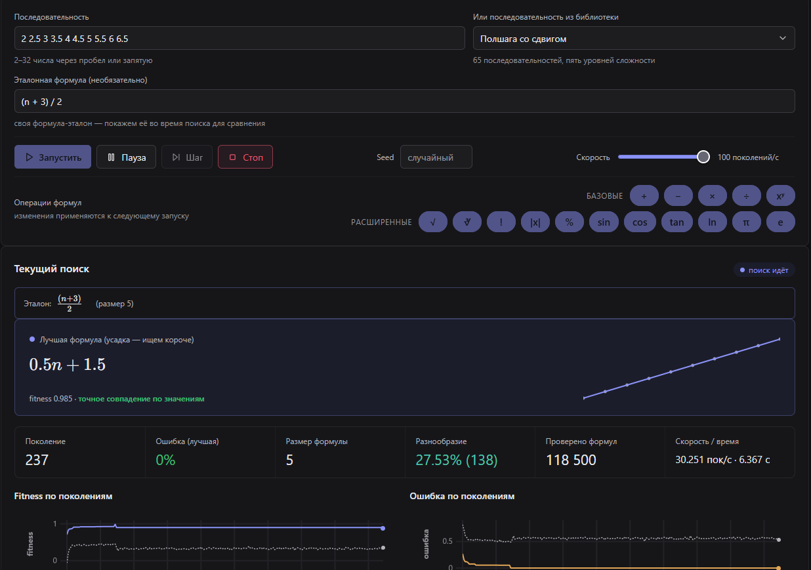

# seq2formula

[English](README.md) · **Русский**


seq2formula — локальный эксперимент в области символьной регрессии: по
конечной числовой последовательности система ищет замкнутую формулу f(n),
которая её порождает: «1 2 4 8 16» → `2^n`. Поиск устроен как эволюционный
цикл (генетическое программирование), позже на ту же базу встанет движок
с обучением с подкреплением; каждое поколение транслируется на дашборд в
браузере в реальном времени.



Проект — длительный личный эксперимент, а не законченный продукт:
грамматика, движки и дашборд планируют развиваться итеративно, а
результаты — включая обученные модели, когда появится нейродвижок —
предполагается сохранять, сравнивать и улучшать со временем. Всё работает
локально: поиск выполняет Python-движок, показ — страница в браузере,
доступ к сети не используется и не нужен.

## Как это работает

- Кандидаты — деревья выражений над небольшой грамматикой: `n`, числовые
  константы (плюс π и e), `+ - * / ^ %` (остаток), унарный минус и
  функции — `sqrt`, кубический корень, факториал, `abs`, `sin`, `cos`,
  `tan`, `ln`.
- Какие операции и функции доступны поиску — решаешь ты: выключи любую и
  посмотри, найдёт ли эволюция другой путь (и как именно она
  выкручивается). Базовые включены по умолчанию, расширенные — в один
  клик.
- Приспособленность складывается из **точности** (кандидат вычисляется на
  n = 1..N; чем ближе значения к целевой последовательности, тем лучше) и
  **лаконичности** (при равной точности побеждает более короткая формула —
  это удерживает ответы читаемыми и отсекает гигантские «формально
  правильные» монстры).
- Правильность проверяется по значениям, а не по тексту: `n+n` и `2*n` —
  один и тот же ответ; наличие нескольких разных правильных формул для
  одной последовательности — нормальный результат.

## Дашборд

Поиск наблюдаем от начала до конца: лучшая формула текущего поколения
(рендер KaTeX), топ-5 формул поколения с местами, живая хроника поиска
(новые рекорды, точные попадания, усадка формул), динамика
приспособленности и ошибок по поколениям, разнообразие популяции,
распределение размеров формул, ошибка по каждому члену, история решённых
загадок, зал славы самых коротких формул и галерея любопытных «почти
попаданий». Прогон можно в любой момент поставить на паузу, пройти
поколение за поколением или ускорить.

## Быстрый старт

Нужен Python 3.10+.

```bat
git clone https://github.com/OlyoshaOlyosha/seq2formula.git
cd seq2formula
python -m venv .venv
.venv\Scripts\pip install -r requirements.txt
run.bat
```

`run.bat` поднимает локальный сервер и открывает дашборд в браузере.

## Статус и направления

Экспериментальный проект в постоянном развитии.

- Стадия 1 (готова) — эволюционный движок с «фазой усадки» после
  решения, живой дашборд, выбор доступных операций, встроенная
  библиотека загадок с нарастающей сложностью.
- Грамматика v2 (готова) — унарные функции (корни, факториал,
  тригонометрия, логарифм), оператор остатка и константы π / e; выбор
  операций разбит на «Базовые» и «Расширенные», тиры T4/T5 демонстрируют
  новые операции (всего 41 загадка).
- Скорость и качество поиска (готово) — вычисление формул через
  компиляцию (поколения в ~3 раза быстрее), механизмы разнообразия
  (штраф за клоны, адаптивные встряски, взвешенная сложность операций),
  перебор настроек по всей библиотеке; хроника рендерит формулы
  математической вёрсткой, любую формулу можно построить графиком рядом
  с её последовательностью.
- Стадия 2 (следующая) — движок с обучением с подкреплением: собирает
  формулу шаг за шагом и обучается вживую, на каждой загадке; обученные
  политики сохраняются, переиспользуются и сравниваются.
- Далее — рекуррентные соотношения, больше статистики, новые
  эксперименты с параметрами движков.

## Заметки

- Интерфейс дашборда — русский: проект развивается прежде всего для
  личного использования.
- Лицензии пока нет; решение отложено сознательно.
